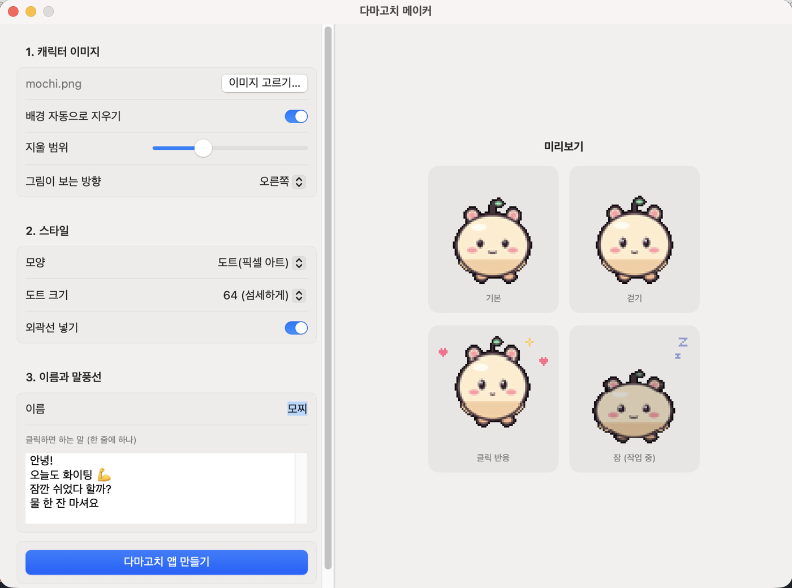

# 다마고치 메이커 (Desktop Pet Maker)

내가 고른 캐릭터 이미지 한 장으로 **macOS 데스크톱 다마고치 앱**을 만들어 주는 프로그램입니다.
만들어진 다마고치는 화면 아래(Dock 위)를 걸어 다니고, 클릭하면 반가워하며 말풍선을 띄우고,
키보드·마우스를 쓰는 동안에는 그 자리에서 잠을 잡니다.




## 이렇게 써요

1. **다마고치 메이커**를 엽니다.
2. 캐릭터 이미지(PNG·JPG)를 창에 끌어다 놓습니다.
   - 배경이 투명한 PNG가 가장 깔끔합니다. 흰색 같은 **단색 배경은 자동으로 지워** 줍니다.
3. 스타일을 고릅니다.
   - **도트(픽셀 아트)**: 32·48·64 칸 크기로 줄여 도트처럼 만들고 외곽선을 넣습니다.
   - **원본 그대로**: 그림을 부드럽게 그대로 씁니다.
4. 이름과 클릭했을 때 할 말(한 줄에 하나)을 적습니다.
5. (선택) **기능**을 켭니다 — 오늘 일정, 지메일, AI 사용량. 아래 [기능](#기능-메일캘린더ai-사용량) 참고.
6. **다마고치 앱 만들기** → 저장할 폴더(기본 `~/Applications`)를 고르면 `이름.app`이 생깁니다.

미리보기에서 네 가지 동작을 바로 확인할 수 있습니다.

| 동작 | 언제 |
|---|---|
| 기본 (숨쉬기) | 걷다가 쉴 때 |
| 걷기 (통통 튀며) | 키보드·마우스를 5초 이상 안 쓸 때 화면 아래를 오감 |
| 클릭 반응 (점프 + 하트) | 클릭했을 때, 말풍선과 함께 |
| 잠 (납작 + Zzz) | 키보드·마우스를 쓰는 동안 |

## 만들어진 다마고치 앱

- 화면 아래를 걸어 다니고, **끌어서** 위치를 옮길 수 있습니다.
- 메뉴바 아이콘에서 바꿀 수 있는 것: 크기(작게/보통/크게), 걷는 속도, 작업 중 잠자기, **로그인할 때 자동으로 켜기**, 종료.
- 여러 마리를 만들어 동시에 띄울 수 있습니다 (이름마다 다른 앱).
- 다른 맥으로 `이름.app`만 복사해도 그대로 동작합니다. 추가 설치가 필요 없습니다.

## 기능: 메일·캘린더·AI 사용량

다마고치에 기능을 켜면 **클릭할 때 패널**이 열리고, 알릴 일이 생기면 **폴짝 뛰며 말풍선**으로 알려 줍니다.

| 기능 | 패널 | 말풍선 | 준비 |
|---|---|---|---|
| 오늘 일정 `calendar` | macOS 캘린더 앱의 오늘 일정 (구글·iCloud·회사 계정) | 시작 10분 전 | 캘린더 접근 허용 |
| 지메일 `gmail` | 안 읽은 메일, 누르면 지메일에서 열기 | 새 메일 | 구글 OAuth 로그인 한 번 |
| AI 사용량 `ai-usage` | Claude Code·Codex 실행 중 세션, 5시간·주간 남은 비율 | 주간 15% 미만 | 없음 (Claude Code 로그인 상태) |

**내가 원하는 기능을 직접 넣는 방법**(날씨, 깃허브, 슬랙, 뽀모도로…)은 👉 **[docs/EXTENDING.md](docs/EXTENDING.md)** 에 따라 하기 예제와 함께 정리해 두었습니다.

## 설치

### 릴리스에서 받기
[Releases](../../releases)에서 `DesktopPetMaker.zip`을 받아 압축을 풀고 `다마고치 메이커.app`을 엽니다.

> 개발자 서명이 없는 앱이라 처음 열 때 macOS가 막을 수 있습니다.
> **앱을 우클릭 → 열기**를 한 번 하거나, 터미널에서 아래를 실행하세요.
> ```
> xattr -dr com.apple.quarantine "다마고치 메이커.app"
> ```

### 소스에서 빌드
macOS 13 이상, Xcode 명령줄 도구(Swift 5.9+)가 필요합니다.

```bash
git clone <이 저장소>
cd desktop-pet-maker
./build.sh            # → build/다마고치 메이커.app, dist/DesktopPetMaker.zip
open "build/다마고치 메이커.app"
```

## 명령줄로 만들기

```bash
"다마고치 메이커.app/Contents/MacOS/PetMaker" --cli 내캐릭터.png \
    --name 몽이 --style pixel --size 48 --say "안녕!|밥 줘|산책 갈까?" --out ~/Applications
```

| 옵션 | 뜻 | 기본값 |
|---|---|---|
| `--name` | 앱 이름 | 파일 이름 |
| `--style` | `pixel`(도트) / `smooth`(원본 그대로) | `pixel` |
| `--size` | 도트 칸 크기 `32` / `48` / `64` | `64` |
| `--facing` | 원본 그림이 보는 방향 `right` / `left` / `front` | `right` |
| `--keep-bg` | 배경 자동 지우기 끄기 | 끔 |
| `--tolerance` | 배경으로 볼 색 차이 (5~120) | `40` |
| `--no-outline` | 도트 외곽선 빼기 | 넣음 |
| `--say` | 말풍선 문구, `\|`로 구분 | 기본 문구 |
| `--features` | 켤 기능, 쉼표로 구분 (`calendar,gmail,ai-usage`) | 없음 |
| `--sheet` | 앱 대신 스프라이트 시트 PNG만 저장 | |
| `--out` | 앱을 만들 폴더 | 현재 폴더 |

## 구조

```
Sources/
  PetMaker/      이미지 → 스프라이트 시트 → 앱 번들 (창 + 명령줄)
    SpriteGen.swift   배경 지우기, 자르기, 도트화·외곽선, 동작 프레임 만들기
    AppBuilder.swift  이름.app 조립 (PetRuntime + sheet.png + pet.json + 아이콘)
    MakerUI.swift     메이커 창 (SwiftUI)
  PetRuntime/    만들어진 다마고치 앱의 엔진 (sheet.png·pet.json 을 읽어 화면에 띄움)
    Features/         기능 플러그인 (오늘 일정·지메일·AI 사용량) ← 새 기능은 여기에
tools/google_login.py 지메일 기능용 구글 로그인
docs/EXTENDING.md     나만의 기능 넣기 가이드
examples/mochi.png    예시 캐릭터 「모찌」
```

만들어진 앱의 `Contents/Resources/`에는 아래 두 파일이 들어갑니다.

- `sheet.png`: 4칸 × 4줄 스프라이트 시트 (기본·걷기·클릭 반응·잠)
- `pet.json`: 이름, 칸 크기, 도트/부드럽게, 보는 방향, 화면 크기, 말풍선 문구, 켤 기능

`sheet.png`를 직접 그려서 바꿔 넣으면 동작 하나하나를 손으로 그린 다마고치도 만들 수 있습니다.

## 알아 두면 좋은 점

- 그림 한 장으로 움직임을 만들기 때문에 동작은 늘이기·눌리기·점프·기울기로 표현됩니다. 눈을 감는 것 같은 표정 변화는 없습니다(잠잘 때는 살짝 어두워지고 Zzz가 뜹니다).
- 작업 감지는 macOS가 기본으로 알려 주는 "마지막 입력 후 지난 시간"만 사용하므로, 손쉬운 사용 같은 추가 권한을 요청하지 않습니다.
- 다른 사람이 만든 캐릭터 이미지를 쓸 때는 저작권을 확인해 주세요.

## 라이선스

MIT
